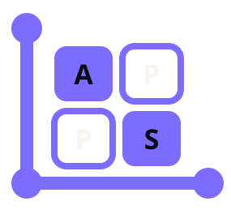
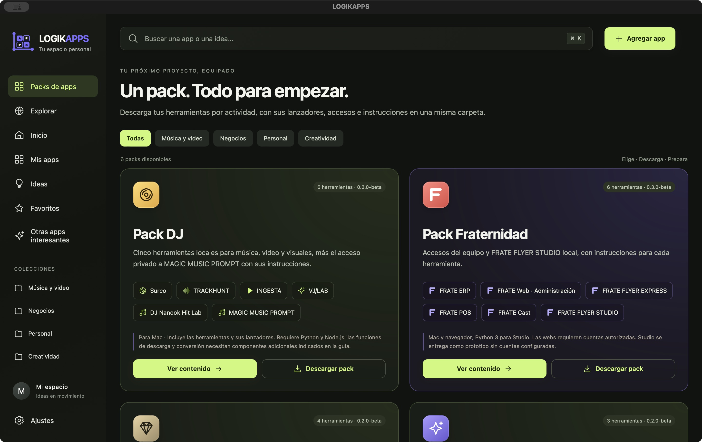

# LOGIKAPPS

[](https://github.com/pablohidalgochile-source/LOGIKAPPS/actions/workflows/check.yml)

**Tus herramientas, a un clic. Un lugar para tu próxima idea.**

LOGIKAPPS reúne packs de herramientas, accesos personales e ideas en una ventana propia para Mac. Elige un pack, prepara lo que quieras usar y conecta sus lanzadores o enlaces a **Mis apps**.



## Descargar para Mac

**[Descargar LOGIKAPPS 0.7.0 beta para Mac](https://github.com/pablohidalgochile-source/LOGIKAPPS/releases/download/v0.7.0-beta.1/LOGIKAPPS-0.7.0-macos-universal.dmg)**

[Notas de la versión y verificación de descarga](https://github.com/pablohidalgochile-source/LOGIKAPPS/releases/tag/v0.7.0-beta.1)

- macOS 13 o posterior; ejecutable universal para Apple Silicon e Intel.
- **Beta sin notarización de Apple.** Consulta [Instalación](docs/INSTALACION.md) si macOS impide abrirla. No se requiere desactivar las protecciones del sistema.
- LOGIKAPPS funciona sin Node.js ni Python. Las herramientas de los packs tienen sus propios requisitos.

## Novedades de 0.7.0

Guía para el compañero con las ocho apps nuevas; NANOOKEY incluye el prototipo DJ Brain con datos ficticios y Estudio Multicam abre correctamente sus rutas locales.

## Apps disponibles

La distribución incluye Elephant y ocho herramientas que faltaban en los packs: Mi Talla, Orgalina, Jacinta M. Pastelería, FRATE FLYER STUDIO, CLUB SANTA CRUZ, Subtitle Translator Pro, Estudio Multicam y NANOOKEY. INGESTA sustituye al nombre anterior NANOOK VIDEO y se entrega en versión 3.0.4; TRACKHUNT incorpora Playlist Hunt y las conexiones recientes en su edición local.

Elephant y Trueke muestran sus logos confirmados. Las identidades por decidir se mantienen pendientes. Las fichas indican versiones verificadas, prototipos y requisitos. Se conserva la recuperación de apertura de 0.5.1 para el caso de ventana negra; aún debe comprobarse el resultado en el otro Mac físico.

## Elige tu pack

| Pack | Fichas | Contenido |
|---|---:|---|
| [Pack DJ](https://github.com/pablohidalgochile-source/LOGIKAPPS/releases/download/v0.7.0-beta.1/LOGIKAPPS-Pack-DJ-0.3.0-beta.zip) | 6 | Surco, TRACKHUNT, INGESTA, VJ/LAB, DJ Nanook Hit Lab, MAGIC MUSIC PROMPT |
| [Pack Fraternidad](https://github.com/pablohidalgochile-source/LOGIKAPPS/releases/download/v0.7.0-beta.1/LOGIKAPPS-Pack-Fraternidad-0.3.0-beta.zip) | 6 | FRATE ERP, FRATE Web · Administración, FRATE FLYER EXPRESS, FRATE POS, FRATE Cast, FRATE FLYER STUDIO |
| [Pack Diseño y Joyería](https://github.com/pablohidalgochile-source/LOGIKAPPS/releases/download/v0.7.0-beta.1/LOGIKAPPS-Pack-Diseno-0.2.0-beta.zip) | 4 | Taller Teatina, FRATV para OBS, Elephant, Mi Talla |
| [Pack IA y Equipo](https://github.com/pablohidalgochile-source/LOGIKAPPS/releases/download/v0.7.0-beta.1/LOGIKAPPS-Pack-IA-Equipo-0.2.0-beta.zip) | 3 | FrateIA · Prueba, ChatGPT y Codex Cloud, ArtCraft |
| [Pack Organización](https://github.com/pablohidalgochile-source/LOGIKAPPS/releases/download/v0.7.0-beta.1/LOGIKAPPS-Pack-Organizacion-0.1.0-beta.zip) | 2 | Orgalina, Jacinta M. Pastelería |
| [Pack Laboratorio](https://github.com/pablohidalgochile-source/LOGIKAPPS/releases/download/v0.7.0-beta.1/LOGIKAPPS-Pack-Laboratorio-0.1.1-beta.zip) | 4 | CLUB SANTA CRUZ, Subtitle Translator Pro, Estudio Multicam, NANOOKEY |

Abre la guía incluida en cada ZIP. **Descargar un pack no instala sus dependencias ni concede permisos en sitios privados.** [Requisitos y límites de cada herramienta](docs/CONTENIDO.md) · [Guía de incorporación](docs/PRIMEROS-PASOS-EQUIPO.html).

## Otras apps interesantes

**Otras apps interesantes** incluye [ArtCraft](https://getartcraft.com/apps), con su página oficial de apps y descargas. Cada herramienta externa mantiene sus requisitos y condiciones.

## Para tu compañero

La [guía incluida en el instalador](docs/PRIMEROS-PASOS-EQUIPO.html) indica dónde descargar las ocho apps nuevas y cómo conectarlas sin duplicados. NANOOKEY incluye DJ Brain con ejemplos ficticios; Multicam incorpora sus rutas locales corregidas. Las webs privadas necesitan invitación y los prototipos conservan sus límites.

## Empieza a usar LOGIKAPPS

1. Instala la app y ábrela. Con una biblioteca vacía verás **Packs de apps**.
2. Elige **Ver contenido**, descarga el pack y sigue su guía. Para una herramienta local, prepara sus requisitos y usa **Conectar lanzador** para seleccionar el archivo `Abrir … .command`; para una web, usa **Agregar a Mis apps**.
3. También puedes usar **Agregar app** para conectar tus propias aplicaciones, enlaces o carpetas. Organiza los accesos por colecciones y marca tus favoritos.
4. Guarda una **Nueva idea**, cambia su etapa y vincúlala a una herramienta cuando exista.
5. Para conservar el icono: menú del icono en el Dock → **Opciones → Mantener en el Dock**.

**Las bibliotecas existentes se conservan al actualizar.** Si ya tienes accesos, seguirás viéndolos en Mis apps y podrás abrir Packs de apps desde la barra lateral. Si la beta anterior te aparecía vacía, instala esta versión y vuelve a abrirla: aparecerán los packs sin importar la biblioteca de otra persona.

## Funciones

- Packs por actividad con contenido, requisitos e instrucciones de inicio.
- Catálogo Explorar con enlaces públicos y descargas individuales.
- Búsqueda de packs, herramientas e ideas, con o sin acentos.
- Colecciones, favoritos y accesos recientes.
- Agregar, editar y quitar accesos sin eliminar las aplicaciones originales.
- Ideas con descripción, etapas y vínculo a una herramienta existente.
- Exportar y restaurar tu biblioteca con copia previa de seguridad.
- Interfaz local sin cuenta de LOGIKAPPS, publicidad, analítica ni servicios de IA.

Los enlaces y herramientas que abras pueden necesitar internet o sus propias cuentas. **Ver carpeta** abre Finder. Escribir una idea no genera automáticamente una aplicación.

## Tus datos

La edición de Mac guarda la biblioteca en `~/Library/Application Support/LOGIKAPPS/`. Reinstalar la app conserva esa biblioteca. Packs y Explorar están separados de los accesos, ideas y favoritos personales; no los reemplazan ni los publican.

Importar una copia reemplaza la biblioteca actual y conserva una copia anterior. Una exportación puede contener nombres de proyectos, notas, enlaces y rutas: revísala antes de compartirla. Las rutas de un Mac no necesariamente existen en otro.

La interfaz también puede abrirse como **vista web** desde `web/index.html`; guarda sus datos en ese navegador. El lanzamiento de herramientas del Mac requiere la app nativa. Ambas vistas tienen bibliotecas independientes.

## Compilar y probar

En un Mac con las herramientas de desarrollo de Apple:

```sh
git clone https://github.com/pablohidalgochile-source/LOGIKAPPS.git
cd LOGIKAPPS
./scripts/build-macos.sh
./.build/LOGIKAPPS.app/Contents/MacOS/LOGIKAPPS --self-test
```

Con Node.js instalado, ejecuta las pruebas de interfaz y FRATV:

```sh
node --test tests/*.test.cjs
```

Para comprobar la interfaz real, usa una carpeta temporal y una sesión gráfica de macOS:

```sh
LOGIKAPPS_DATA_DIR="$(mktemp -d /tmp/logikapps-smoke.XXXXXX)" \
  ./.build/LOGIKAPPS.app/Contents/MacOS/LOGIKAPPS --ui-smoke-test
```

Para crear los paquetes y el instalador:

```sh
python3 scripts/package-surco.py
python3 scripts/package-fratv.py
python3 scripts/package-packs.py
python3 scripts/check-packs.py
./scripts/create-dmg.sh
```

Consulta [Distribución](docs/DISTRIBUCION.md) para compilar, verificar, firmar y notarizar una futura entrega.

## Estado de esta beta

La suite principal incluye pruebas de interfaz/FRATV y almacenamiento nativo. La prueba de interfaz recorre los ocho packs y sus 37 fichas, además de la biblioteca personal. Consulta los resultados y límites en [Verificación](docs/VERIFICACION.md).

La validación local se realiza en Apple Silicon; el ejecutable universal contiene también Intel. No se afirma que todas las herramientas o versiones de macOS estén certificadas. En esta preparación no se descargó música de plataformas, no se capturó audio ni se realizaron operaciones dentro de los sistemas de Fraternidad. Hit Lab sí se comprobó exportando un sonido sintetizado por la propia herramienta.

Los resultados remotos aparecen en [GitHub Actions](https://github.com/pablohidalgochile-source/LOGIKAPPS/actions/workflows/check.yml). Puedes comunicar fallos en [Issues](https://github.com/pablohidalgochile-source/LOGIKAPPS/issues), indicando versión de macOS y pasos para reproducirlos, sin adjuntar datos personales ni credenciales.
